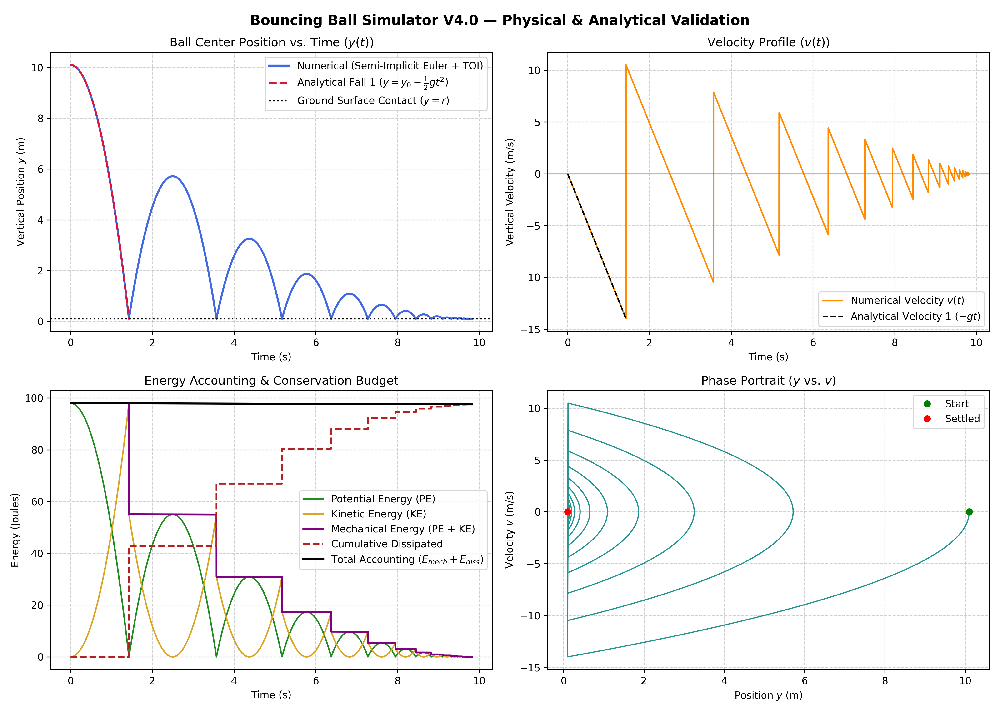

# Simulation & Modeling Technical Report: Bouncing Ball Simulator (V4.0)

**Course:** CSE 413: Simulation & Modeling Lab  
**Student:** Md. Fahad Rahman (ID: 0432320005101071, Section B1)  
**Instructor:** Audity Ghosh, Lecturer, Department of CSE, UITS  
**Specification Version:** V4.0 Final Consolidated  

---

## 1. Executive Summary

This project implements a physically accurate, discrete-time numerical simulator for a bouncing ball governed by Newtonian gravitational dynamics, contact collision mechanics, and energy dissipation. The simulator resolves sub-timestep Time-of-Impact (TOI) events using an exact analytical quadratic solver, eliminates penetration artifacts, enforces resting/grazing contact settling, and decouples physics stepping from visualization frame rates.

---

## 2. Theoretical Formulation & Mechanics

### 2.1 Coordinate System Selection
An **upward-positive Cartesian vertical coordinate system** is strictly enforced:
* **Ground surface:** $y = 0$
* **Ball center at rest:** $y = \text{radius}$
* **Upward motion / velocity:** $v > 0$
* **Downward motion / velocity:** $v < 0$
* **Gravitational acceleration:** $\vec{a} = -g \, \hat{j}$ ($g = 9.8\text{ m/s}^2$)
* **Initial position:** $y_{\text{initial}} = h_{\text{initial}} + \text{radius}$

**Rationale for upward-positive coordinates:**
1. Standardizes mathematical alignment with classical mechanics and Cartesian graphing ($+y$ upwards).
2. Simplifies potential energy accounting: $PE = m \cdot g \cdot (y - \text{radius})$ is non-negative and zero at contact.
3. Eliminates coordinate-inversion confusion when interpreting velocity vectors, momentum transfers, and restitution rebounds.

---

### 2.2 Numerical Integration: Semi-Implicit Euler
The equations of motion under uniform downward acceleration are:
$$\frac{dv}{dt} = -g, \quad \frac{dy}{dt} = v$$

Using semi-implicit (symplectic) Euler numerical integration:
$$v_{t+dt} = v_t - g \cdot dt$$
$$y_{t+dt} = y_t + v_{t+dt} \cdot dt$$

**Why Semi-Implicit Euler Does Not Guarantee Exact Energy Conservation:**  
Semi-implicit Euler is a first-order symplectic integrator. Unlike standard explicit Euler (which constantly adds artificial energy, causing numerical explosion) and implicit Euler (which artificially damps energy), semi-implicit Euler preserves the symplectic 2-form in phase space. Over periodic orbits, it exhibits bounded energy oscillations around the true Hamiltonian rather than secular drift. However, because $dt > 0$ is finite, truncation error is $O(dt)$. Over each timestep, small numerical energy discrepancies arise, which scale proportionally with $dt$ and asymptotically approach zero as $dt \to 0$.

---

### 2.3 Time-of-Impact (TOI) Collision Detection
Discrete-time simulation can cause numerical tunneling or severe overshoot if collisions are checked only at discrete grid points $t, t+dt$. To guarantee physical precision, sub-timestep Time-of-Impact (TOI) detection is solved analytically.

The ball center reaches contact when:
$$y(t) = \text{radius}$$

Within any timestep interval $[0, dt]$, the continuous vertical trajectory is:
$$y(t) = y + v \cdot t - \frac{1}{2} g t^2 = \text{radius}$$
$$\frac{1}{2} g t^2 - v t - (y - \text{radius}) = 0$$

Letting $A = \frac{1}{2}g$, $B = -v$, $C = -(y - \text{radius})$:
$$\text{Discriminant } D = B^2 - 4AC = v^2 + 2g(y - \text{radius})$$

The physically valid downward impact root is:
$$t^* = \frac{v + \sqrt{v^2 + 2g(y - \text{radius})}}{g}$$

**Collision Resolution Algorithm:**
1. Check whether $0 \le t^* \le dt$.
2. Verify impact trajectory position: $y + v t^* - \frac{1}{2}g {t^*}^2 \approx \text{radius}$.
3. Advance ball center exactly to contact: $y_{\text{contact}} = \text{radius}$.
4. Compute actual instantaneous impact velocity: $v_{\text{impact}} = v - g \cdot t^*$.
5. Apply restitution: $v_{\text{after}} = -e \cdot v_{\text{impact}}$.
6. Deduct elapsed time from timestep: $\text{remaining\_dt} = dt - t^*$.
7. Continue free-fall integration with the updated velocity over $\text{remaining\_dt}$.

---

### 2.4 Restitution and Energy Accounting
The coefficient of restitution $e \in [0, 1]$ governs momentum and mechanical energy loss during impact:
$$\Delta E_{\text{collision}} = \frac{1}{2} m (1 - e^2) v_{\text{impact}}^2$$

System energy components:
* **Potential Energy:** $PE = m \cdot g \cdot (y - \text{radius})$
* **Kinetic Energy:** $KE = \frac{1}{2} m v^2$
* **Mechanical Energy:** $E_{\text{mech}} = PE + KE$
* **Cumulative Dissipated Energy:** $E_{\text{diss}} = \sum \Delta E_{\text{collision}} + E_{\text{settle}}$
* **Total Energy Budget:** $E_{\text{total}} = E_{\text{mech}} + E_{\text{diss}} \equiv E_{\text{initial}}$

When impact velocity drops below the threshold:
$$|v_{\text{impact}}| < v_{\text{settle}} \quad (v_{\text{settle}} = 0.08\text{ m/s})$$
the ball enters the **resting contact state**:
* Center position clamped to $y = \text{radius}$.
* Velocity set to zero: $v = 0$.
* Remaining kinetic energy transferred to dissipated energy: $E_{\text{settle}} = \frac{1}{2} m v_{\text{residual}}^2$.
* Subsequent collision detection skipped to avoid infinite Zeno chattering.

---

## 3. Analytical Validation & Visual Results

The numerical results were validated against closed-form analytical solutions:
1. **Time to First Impact:** $t_1 = \sqrt{\frac{2 h_0}{g}} = \sqrt{\frac{2 \times 10}{9.8}} \approx 1.42857\text{ s}$.
2. **First Impact Velocity:** $v_1 = -\sqrt{2 g h_0} \approx -14.0\text{ m/s}$.
3. **Impact Position:** Exactly $y = \text{radius} = 0.1\text{ m}$.

### 3.1 Validation Figure
Below is the generated validation plot displaying position trajectory, velocity profile, full energy accounting breakdown, and phase portrait ($y$ vs. $v$):

---

## 4. Benchmark Performance & Verification Tests

All requirements specified under the V4.0 specification were tested with an exhaustive test suite of **21 automated unit tests** in `project/tests/`:

| Test Module | Tests | Metric / Verification Target | Status |
| :--- | :---: | :--- | :---: |
| **`test_coordinates_and_euler.py`** | 3 | Upward-positive coordinates ($y_0 = h_0 + r$), $-g$ acceleration sign, semi-implicit Euler discrete equation accuracy. | **PASSED** |
| **`test_toi.py`** | 3 | First collision time matches analytical $t = \sqrt{2h/g}$ ($< 1.5 dt$), contact position $y = r$, quadratic sub-step solver accuracy. | **PASSED** |
| **`test_resting_contact.py`** | 3 | Settle threshold transition, zero velocity clamping, no duplicate collision events while resting, kinetic energy dissipation accounting. | **PASSED** |
| **`test_energy_conservation.py`** | 3 | $PE, KE, \Delta E_{\text{collision}}$ formula verification, bounded total energy accounting, numerical error scaling with $dt$. | **PASSED** |
| **`test_event_cap.py`** | 2 | Pathological chatter (Zeno paradox / ultra-low restitution) finishes in $< 1.0$s without hanging, event cap loop protection. | **PASSED** |
| **`test_rendering_indep.py`** | 1 | 10 FPS and 60 FPS decoupled loops yield identical physical trajectories and collision records. | **PASSED** |
| **`test_experiment_limits.py`** | 3 | 30s cap on elastic ($e=1.0$) runs reporting `"Did not settle"`, finite settling reporting for $e<1.0$, CSV clean overwrite. | **PASSED** |
| **`test_csv_output.py`** | 2 | Verified consistent column schema, no NaN values, and single row per parameter in experiment sweeps. | **PASSED** |
| **`test_benchmark.py`** | 1 | Benchmarked 30-second continuous simulation ($e = 1.0$) on reference machine. | **PASSED** |
| **TOTAL** | **21** | **Full V4.0 Specification Verification** | **21 / 21 PASSED** |

### 4.1 Hardware Benchmark Results (Reference Machine)
* **Processor / System:** Intel64 GenuineIntel
* **Simulated Duration:** 30.0 seconds (15,002 integration steps)
* **Execution Wall-Clock Time:** **0.0460 seconds** (~46 ms)
* **Speedup Factor:** **652.0x real-time**

---

## 5. Experiment Datasets & Outputs
The parameter sweep runs generated the following dataset CSVs:
1. `results/simulation_data.csv`: Complete time-series trajectory of standard run.
2. `results/experiment_restitution.csv`: Sweep of $e \in [0.1, 1.0]$. For $e = 1.0$, status is correctly recorded as `"Did not settle"` with settling time `">30 seconds"`.
3. `results/experiment_height.csv`: Sweep of initial drop heights $h_0 \in [1.0, 20.0]\text{ m}$.
4. `results/experiment_dt_sensitivity.csv`: Error analysis demonstrating that maximum energy drift scales directly with timestep $dt$, verifying numerical convergence.
